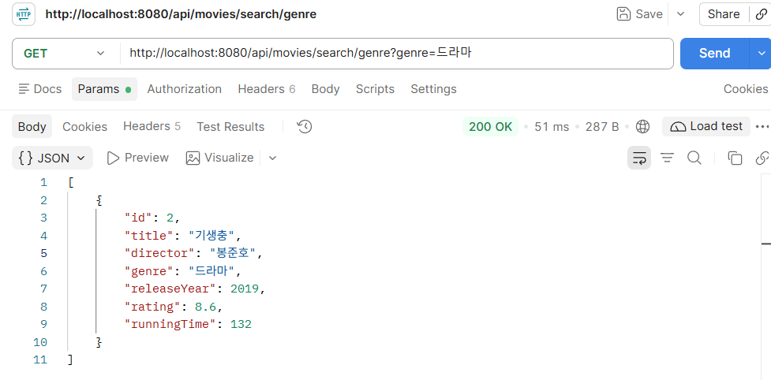
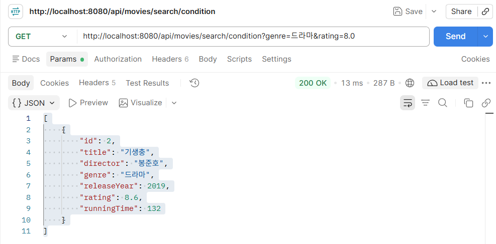
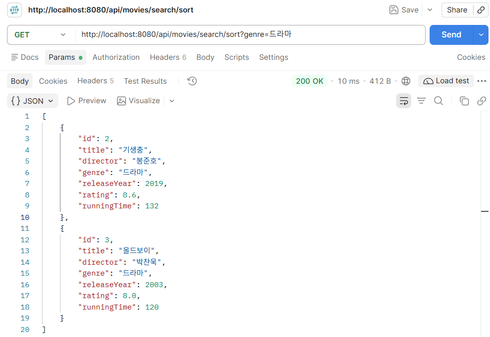
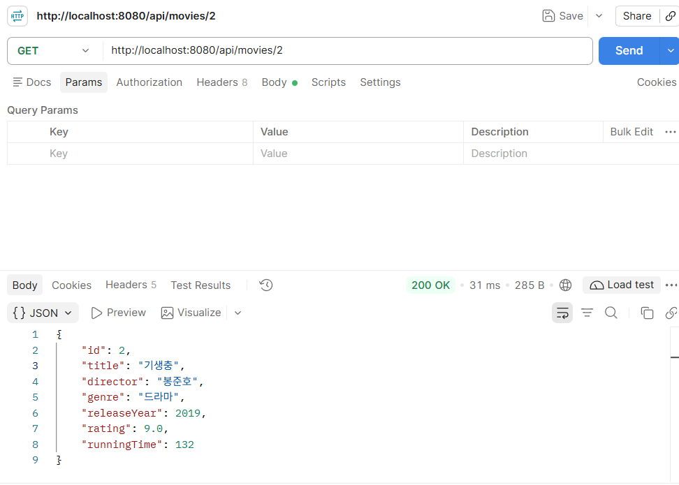
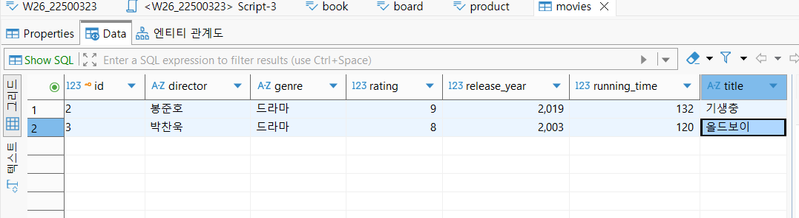
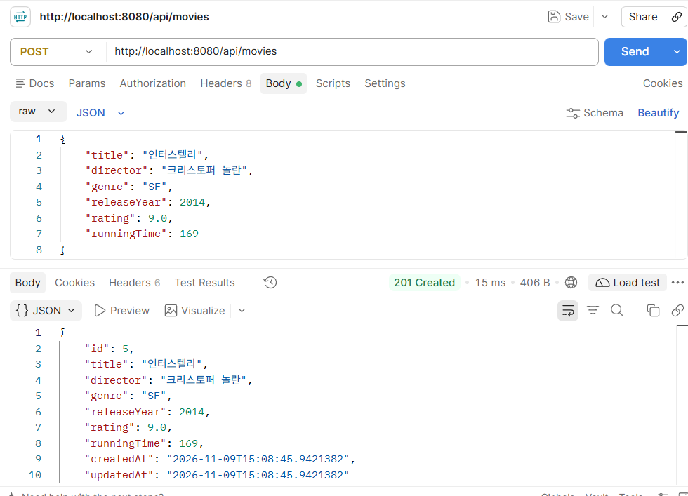
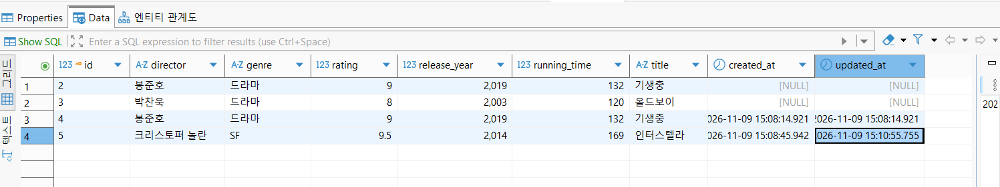

1. 프로젝트 소개 : Spring data JPA를 사용하여 영화 정보를 관리하는 CRUD프로젝트
GitHub (개인) :
GitHub : 
Render : 
2. Query Method 3개: 검색 조건 및 API 실행 결과

3. Dirty Checking: 수정 기능 구현 및 실행 결과

4. Auditing: 생성·수정 시간 자동 기록 결과

5. 새롭게 배운 내용
- Query Method를 사용하면 메서드 이름만으로 다양한 검색 조건을 만들 수 있다는 것을 배움
- JPA Auditing을 사용하면 데이터의 생성 시간과 수정 시간을 자동으로 관리할 수 있다는 것을 배움
6. 여려웠던 점과 해결방법 : Dirty Checking과 JPA Auditing이 실제로 어떻게 동작하는지 이해하는 것이 어려웠음
Postman으로 API를 테스트하고 DBeaver에서 데이터베이스 값을 직접 확인하면서 문제를 해결
7. 느낀점 : 처음에는 어노테이션과 메서드 이름 규칙이 익숙하지 않았지만 직접 코드를 작성하고 테스트하면서 조금씩 이해할 수 있었음
8. AI usage
사용 도구: ChatGPT
활용 내용: Query Method 작성, Dirty Checking 구현, JPA Auditing 적용, 오류 해결
AI가 제안한 코드를 그대로 사용하기보다는 프로젝트에 맞게 수정하고 Postman과 DBeaver로 직접 테스트했습니다.
AI 활용 비율: 약 45% 